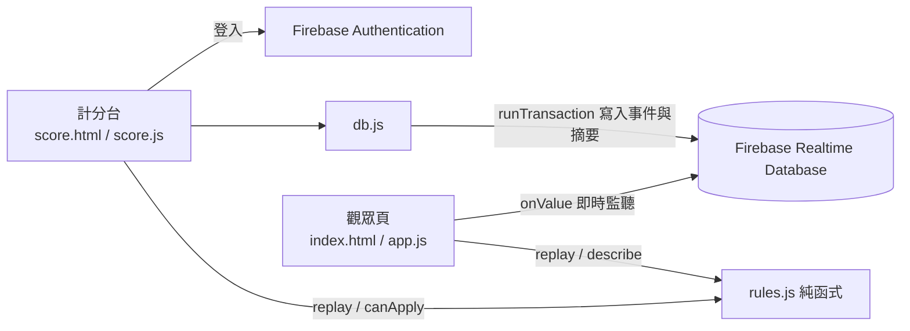
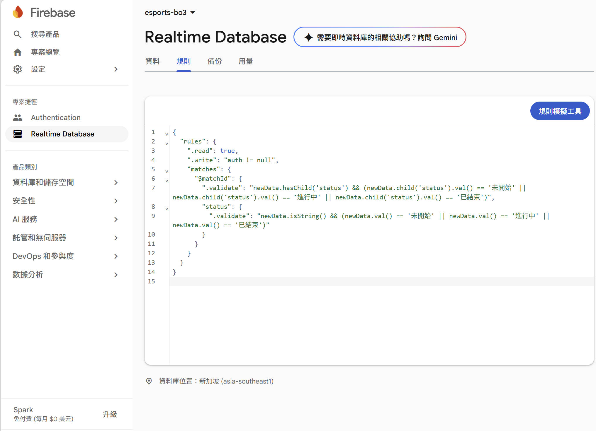
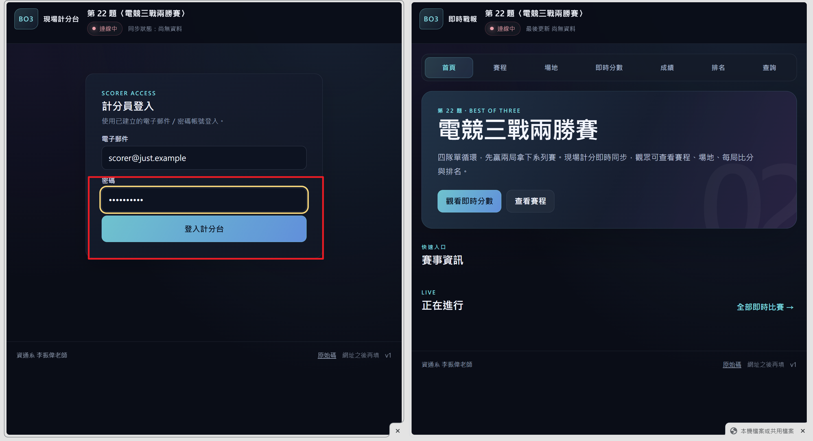

# 第 22 題〈電競三戰兩勝賽〉即時計分系統

## 專案資訊

- 賽事名稱：第 22 題〈電競三戰兩勝賽〉
- 作者：資通系 李振偉老師（學號：待補）
- 觀眾頁：[開啟賽事](https://appjust.github.io/esports-bo3/)
- 計分台：[開啟計分台](https://appjust.github.io/esports-bo3/score.html)
- 規則測試：[開啟 test.html](https://appjust.github.io/esports-bo3/test.html)
- 計分員帳號：`scorer@just.example`
- 密碼：老師統一規定的密碼
- 版本：v2

> `scorer@just.example` 是計分員登入帳號；本 README 不保存密碼。請勿將密碼放入原始碼、網址或公開文件。

## 系統架構



計分員在計分台按下擊殺或推塔加分時，計分台會建立 `RECORD_SCORE` 動作。`db.js` 以一次 Realtime Database transaction 新增事件、重算並更新比賽摘要及最後更新時間。觀眾頁透過 `onValue` 收到最新資料，再由 `rules.js` 的 `replay()` 和 `describe()` 還原局數、比分、進度圓點與勝方並更新頁面。觀眾頁不需要登入，也不以計時器輪詢。

## Realtime Database 資料結構

| 路徑 | 內容 |
| --- | --- |
| `/meta` | 賽事名稱 `eventName`、版本 `version`、最後更新時間 `lastUpdatedAt`。 |
| `/teams/{teamId}` | 隊伍 ID、假名隊名，以及選手假名 `players`。 |
| `/matches/{matchId}` | 階段 `stage`、雙方隊伍 ID、場地 `venue`／`courtId`、狀態 `status`、目前狀態摘要 `state`。摘要含系列賽比分、已打局數、各局藍紅方與擊殺／推塔比分；比賽結束時也含勝方與獲勝方式。 |
| `/events/{matchId}/{eventId}` | 每一筆計分動作的順序 `sequence`、時間 `timestamp` 和動作 `action`。這份事件紀錄是重建比賽狀態的依據。 |
| `/courts/{courtId}` | 場地 ID、名稱，以及目前使用中的比賽 ID `currentMatchId`（有比賽時才有）。 |

排名、循環賽勝敗場數、小局勝場／敗場與小局勝負差不存入資料庫；這些資料由 `rules.js` 的 `standings()` 根據已結束的循環賽事件重算。比賽比分和每局資訊也可由事件重播還原，`/matches` 的 `state` 是方便即時顯示的摘要。

## Firebase 安全規則

本專案的 `database.rules.json` 設定如下：

```json
{
  "rules": {
    ".read": true,
    ".write": "auth != null",
    "matches": {
      "$matchId": {
        ".validate": "newData.hasChild('status') && (newData.child('status').val() == '未開始' || newData.child('status').val() == '進行中' || newData.child('status').val() == '已結束')",
        "status": {
          ".validate": "newData.isString() && (newData.val() == '未開始' || newData.val() == '進行中' || newData.val() == '已結束')"
        }
      }
    }
  }
}
```

任何人都能讀取賽事資料；只有已登入的 Firebase 使用者能寫入；比賽狀態只接受「未開始」、「進行中」或「已結束」。目前規則限制的是登入狀態，沒有再限制只能由 `scorer@just.example` 寫入。

Firebase Web App 的 `firebaseConfig` 是前端初始化專案所需的公開設定，不是管理員憑證；資料寫入權限由 Authentication 和 Realtime Database 規則控制。不要公開計分員密碼、服務帳戶私密金鑰或其他伺服器端憑證。

## 計分規則與 `rules.js`

- 一場最多三局，先贏兩局者贏得系列賽。
- 每局可記錄雙方擊殺數、推塔數；擊殺或推塔數不決定局勝負，計分員以「藍方勝」或「紅方勝」判定。
- 每局開始前選藍方；下一局預設由上一局紅方轉任藍方。
- `ACTIONS`／`ACTION_DEFINITIONS` 定義建立比賽、開始本局、記錄分數、判定局勝方等動作。
- `canApply(state, action)` 檢查動作是否符合目前比賽狀態及欄位規則。
- `replay(events)` 從事件紀錄重建比賽狀態；復原就是刪除最後一筆動作後再重播。
- `describe(state)` 產生觀眾用的三戰兩勝圓點、每局擊殺／推塔比分和勝方資訊。
- `standings(teams, matches)` 只統計已結束的循環賽，先比系列賽勝場，再比小局勝負差。
- `roundRobin(teams)` 產生四隊單循環的六場賽程。

## 測試紀錄

`test.html` 上次本機測試共 **14 項，14 項通過**。下列現場與部署測試等實際結果回報後更新；目前不把待測項目標成通過。

| 測試項目 | 紀錄 |
| --- | --- |
| `test.html` 規則測試 | 上次本機：14/14 通過；v2 公開站重新確認：待補。 |
| 兩個視窗即時同步 | 待回報。 |
| 手機離線後恢復連線 | 待回報。 |
| 未登入不能寫入 | 待回報。 |
| 擊殺數比較少的一方也可以被判定獲勝 | `test.html` 上次本機測試：通過；現場確認：待回報。 |
| 2:0 之後不會出現第三局 | `test.html` 上次本機測試：通過；現場確認：待回報。 |
| 第二局預設的藍方是第一局的紅方 | `test.html` 上次本機測試：通過；現場確認：待回報。 |

## 截圖

規則設定：



計分台與觀眾頁介面預覽（此圖是介面截圖，不代表已完成即時同步測試）：



